# OnlineBookStore

A modern online bookstore web application. Customers browse the catalog, read and
write reviews, manage a wishlist, apply promo codes, and track their orders; sellers
run the store from a full admin area with a dashboard, order management, and marketing tools.

## Stack

- Java 17, Spring Boot 3 (Spring MVC, Spring Security, Spring Data JPA, Bean Validation)
- Thymeleaf server-rendered UI (Bootstrap 5 via WebJars)
- PostgreSQL 16 (Flyway-managed schema and seed data); embedded H2 for dev
- Maven

## Features

**Customers**
- Register (email + password, terms acceptance enforced) and log in, with optional
  remember-me for a week
- Browse the catalog with live stock badges (Out of Stock / Only N left / Trending)
- Search books by title or author, with live autocomplete suggestions
- Filter by category, in-stock only; sort by title, author, price, or newest; paginated results
- Public book detail pages with description, metadata, ratings, and reviews
- Star reviews (one per customer per book — re-submitting updates your review)
- Wishlist: save books, move them to the cart later
- "Notify me when available" sign-ups for sold-out books (restock emails are simulated)
- Recently-viewed shelf, "Readers also picked" recommendations per book
- Trending (bestsellers) and New Arrivals shelves, featured picks on the home page
- Session-based shopping cart with per-book quantity controls, capped by available stock
- Promo codes at checkout (percent off, minimum order, usage limits, expiry —
  try `WELCOME10` for 10% off)
- Simulated checkout with address snapshot and instant receipt
- Order lifecycle with status timeline: Placed → Shipped → Delivered (or Cancelled);
  customers can cancel while the order is still placed — stock is returned automatically
- Reorder a past order in one click (respects current stock)
- Printable invoice for every order
- Profile page: edit contact/delivery details and change password
- Contact form + FAQ page; dark mode toggle everywhere

**Sellers (admin)**
- Dashboard: revenue, order count, copies sold, customer count, bestseller chart,
  recent orders, low-stock alerts with one-click +10 restock (triggers notify-me emails)
- Order management: filter by status, mark shipped/delivered, cancel with a reason
- Customer management: list, inspect order history, promote to seller, disable accounts
- Catalog management: add/edit/remove books with category, description, year, pages,
  featured flag; quick restock; book detail pages stay consistent
- Category management CRUD
- Review moderation: hide, unhide, or delete reviews
- Promo code management: create, activate/deactivate, delete
- Contact message inbox with read/unread tracking
- Audit log of the last 100 admin actions
- CSV export of orders, books, and customers
- Restock notifications queue for "notify me" sign-ups

**Platform**
- Read-only JSON API (`/api/books`, `/api/books/{barcode}`, `/api/books/{barcode}/reviews`,
  `/api/categories`) powering the autocomplete and available for integrations
- Transactional, atomic stock purchasing (no overselling); full rollback on failure
- Real error pages with proper HTTP statuses

## Screenshots

### Storefront

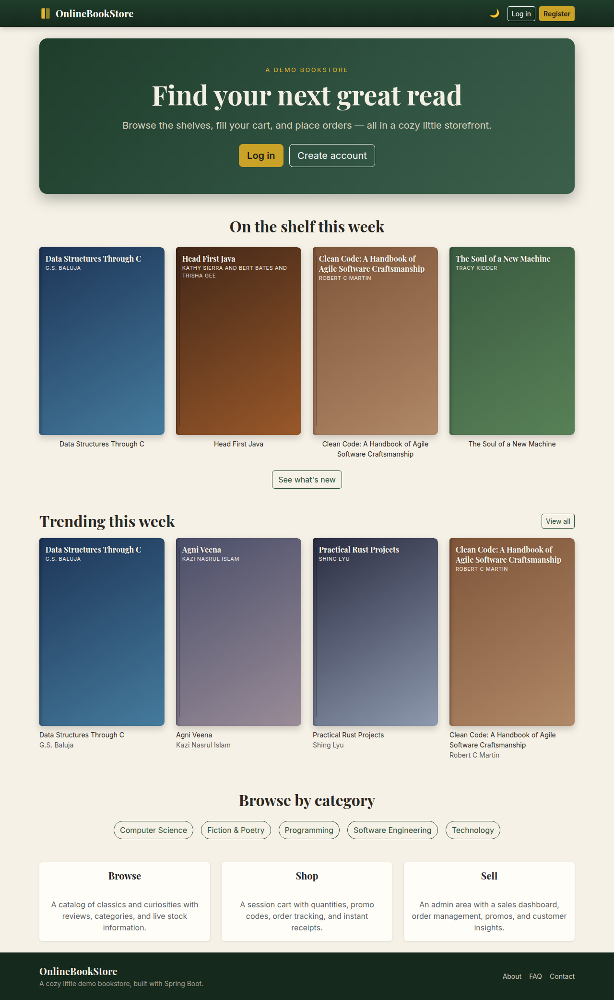

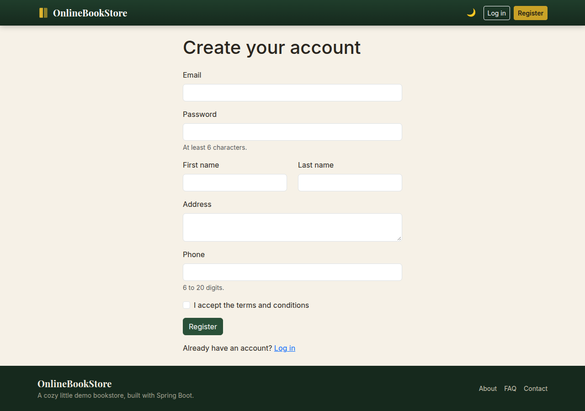

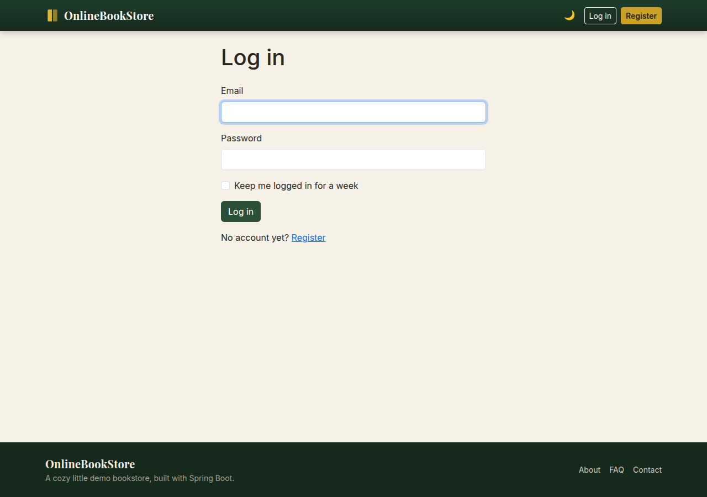

### Customer

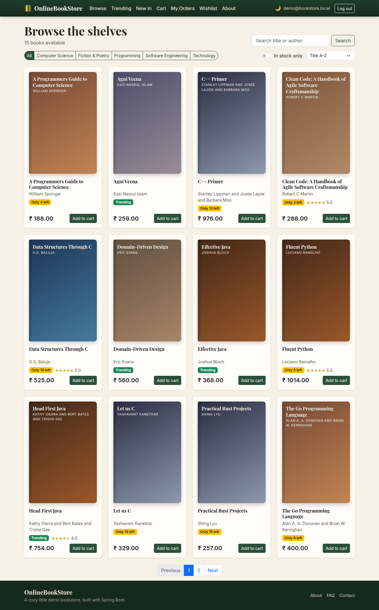

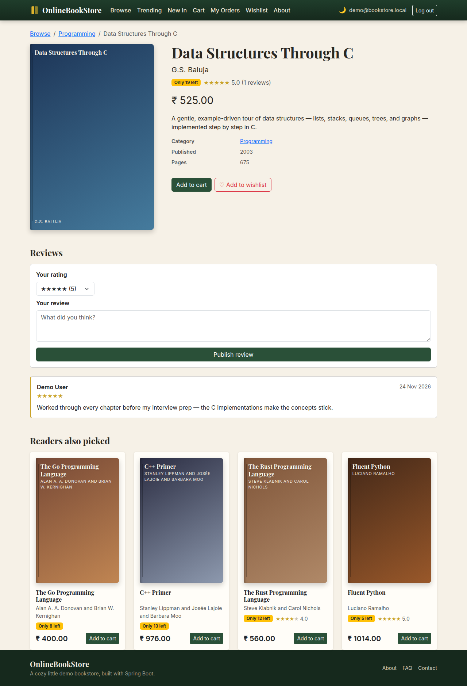

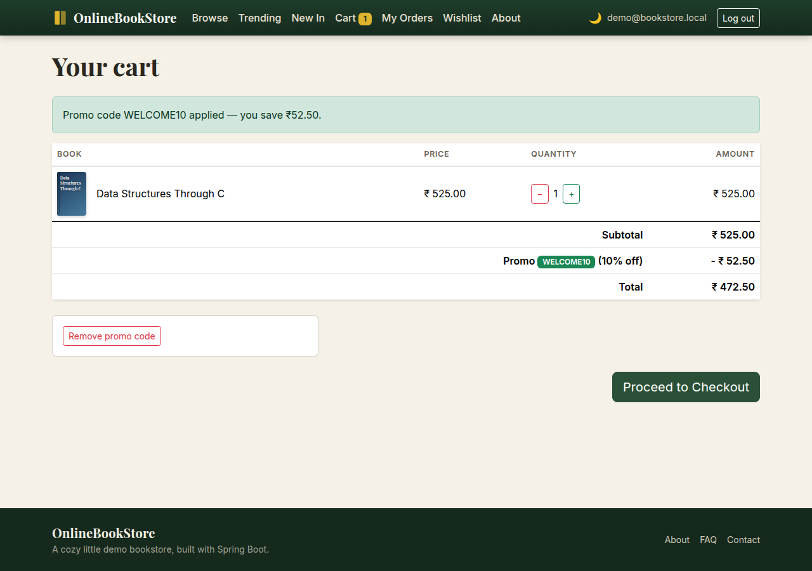

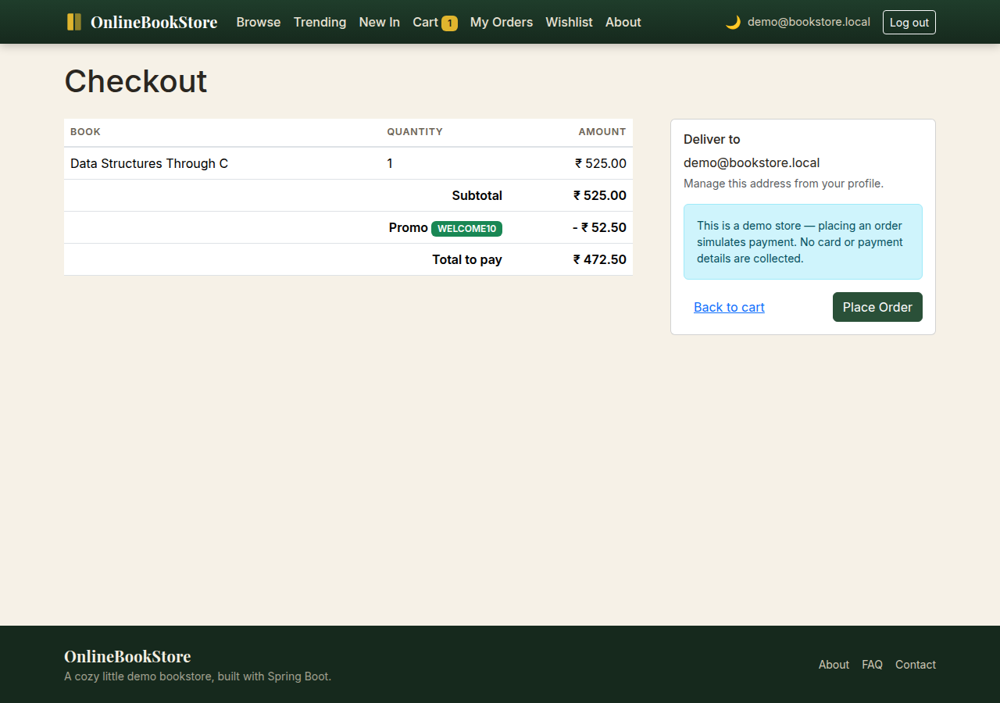

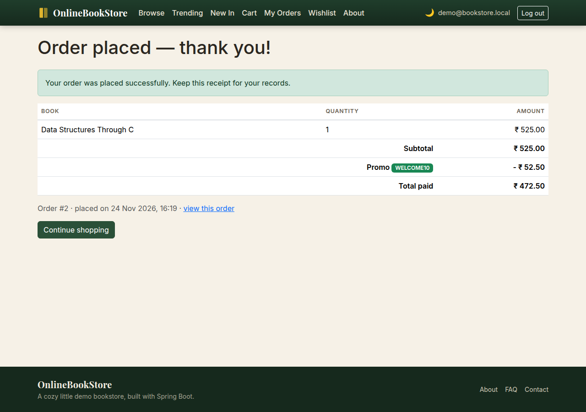

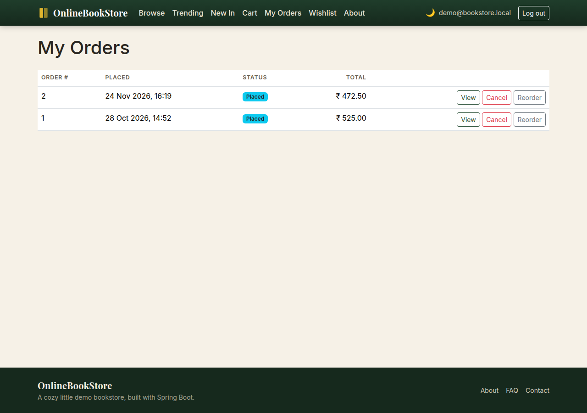

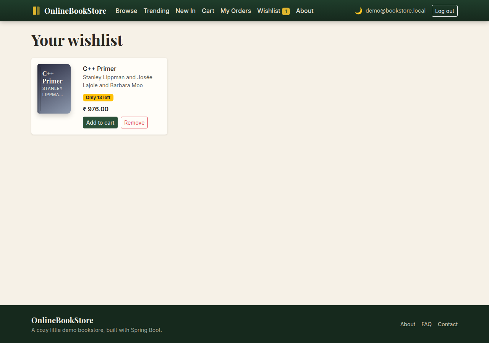

### Seller (admin)

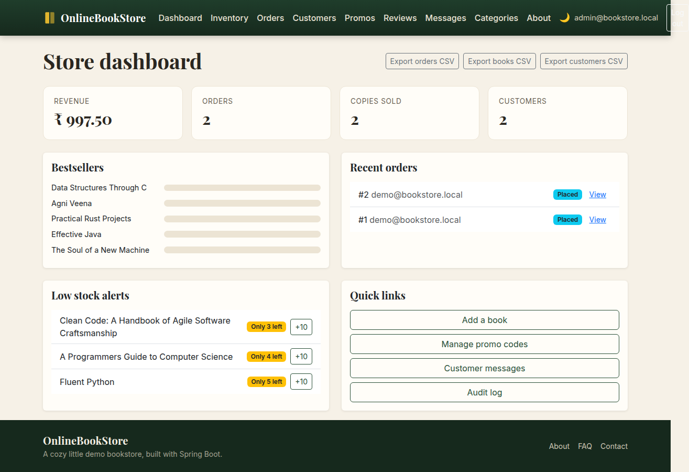

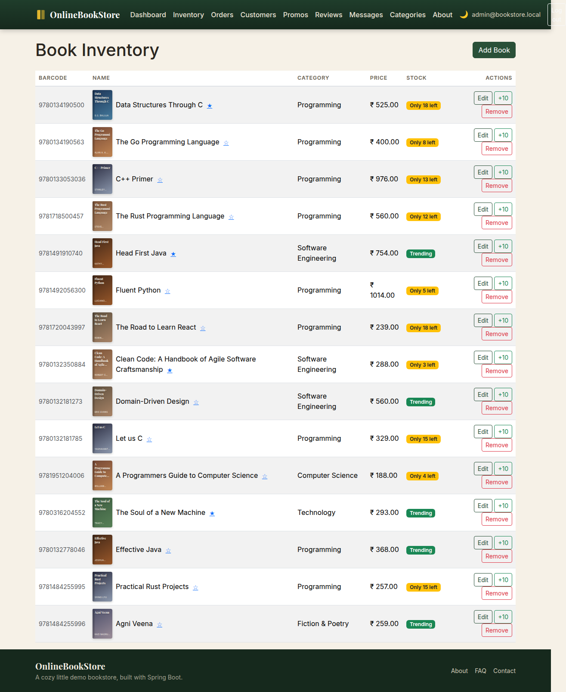

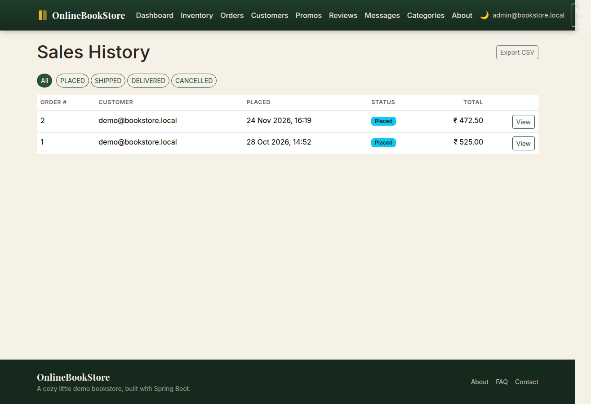

## Quickstart

Prerequisites: JDK 17+ and Maven 3.9+ (or use the Dockerfile).

**Option A — PostgreSQL via Docker:**

```bash
docker compose up -d db
mvn spring-boot:run
```

**Option B — no Docker (embedded H2, file-based):**

```bash
mvn spring-boot:run -Dspring-boot.run.profiles=dev
```

Then open http://localhost:8080

### Demo accounts (seeded on first start)

| Email | Password | Role |
|---|---|---|
| `admin@bookstore.local` | `admin123` | Seller |
| `demo@bookstore.local` | `demo123` | Customer |

These accounts are for local development only — change or remove them before any real deployment.

### Configuration

Environment variables override the database connection:

- `DB_URL` (default `jdbc:postgresql://localhost:5432/onlinebookstore`)
- `DB_USER` / `DB_PASSWORD` (default `bookstore` / `bookstore`)
- `PORT` (default `8080`)

## Repository layout

```
src/main/java/com/onlinebookstore/
  config/        security, demo data seeding
  controller/    web controllers (customer, admin, JSON API, errors)
  dto/           form and receipt objects
  exception/     domain exceptions
  model/         JPA entities and session cart
  repository/    Spring Data repositories
  service/       business logic (incl. transactional stock purchase)
src/main/resources/
  db/migration/  Flyway schema + seed data
  templates/     Thymeleaf templates
  static/        CSS
```

## Building

```bash
mvn clean package          # produces target/onlinebookstore.jar
java -jar target/onlinebookstore.jar
```

Or build and run the Docker image (expects a reachable database via `DB_URL`):

```bash
docker build -t onlinebookstore .
docker run -p 8080:8080 -e DB_URL=jdbc:postgresql://host.docker.internal:5432/onlinebookstore onlinebookstore
```
